# Drzwi do Piękna

Strona gabinetu medycyny estetycznej w Łodzi (lek. Anita Symonowicz) wraz z panelem redakcyjnym. Zastępuje obecny serwis WordPress pod adresem drzwidopiekna.pl: nowy wygląd z naciskiem na telefon, treści edytowane przez gabinet bez programisty oraz przekierowania 301 ze starych adresów, żeby nie stracić pozycji w Google.

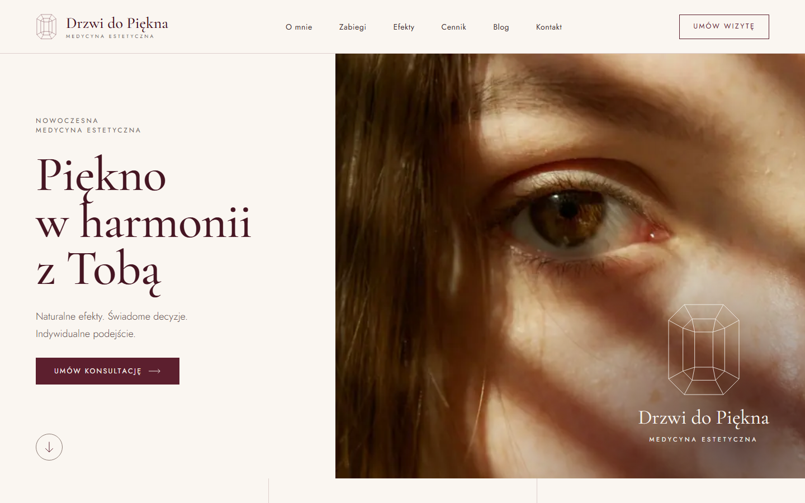

## Co jest w środku

- **Strona publiczna**: strona główna z animacją powitalną (rysowany sygnet i otwierające się drzwi), obszary zabiegów i zabiegi, cennik, zespół, opinie, kontakt z formularzem, blog, polityka prywatności i cookies.
- **Panel redakcyjny** pod `/admin` (Filament 5, po polsku): zabiegi, cennik, zespół, opinie, blog, biblioteka zdjęć, dokumenty prawne i zgłoszenia z formularza. Logowanie dwuskładnikowe (aplikacja + kody odzyskiwania), w produkcji wymagane.
- **Blog w edytorze wizualnym**: zdjęcia z biblioteki wstawiane blokami, tabele, cytaty, wpisy planowane na przyszłą datę.
- **Zdjęcia**: wgrywane w panelu, zamieniane na WebP w kilku szerokościach, wybierane z biblioteki w formularzach.
- **Formularz kontaktowy**: zgłoszenia trafiają do bazy (bez adresu IP) i do gabinetu e-mailem, a osoba zgłaszająca dostaje ładną wiadomość z potwierdzeniem (limit 2 na godzinę na adres).
- **SEO**: title, description, canonical, Open Graph i JSON-LD dla każdej strony, mapa strony, 70 przekierowań 301 ze starych adresów WordPressa.
- **SSR**: strony renderuje serwer (Inertia + Vue), więc roboty wyszukiwarek dostają gotowy HTML.

### Strona publiczna

| | |
|---|---|
| 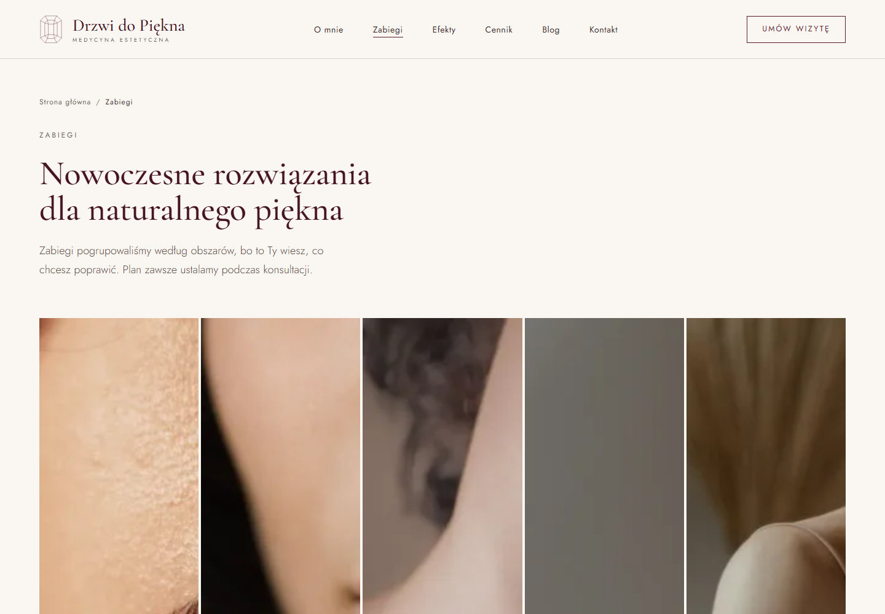 | 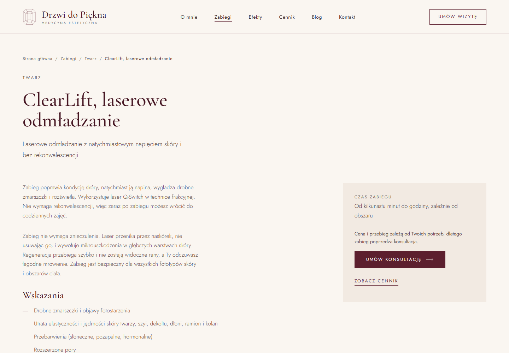 |
| 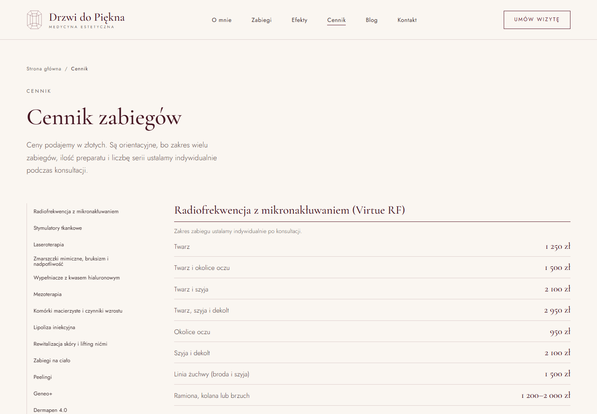 | 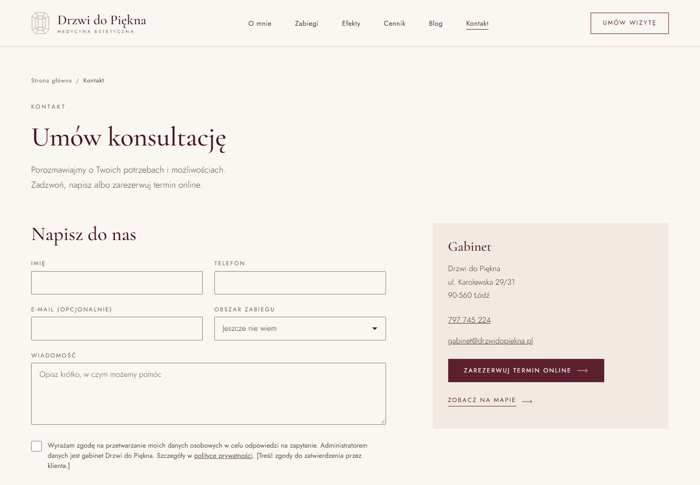 |
| 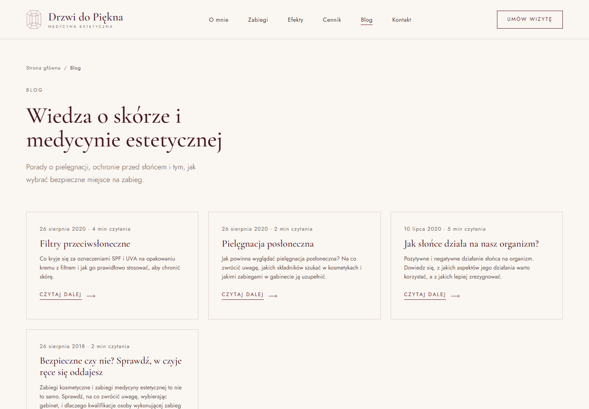 | 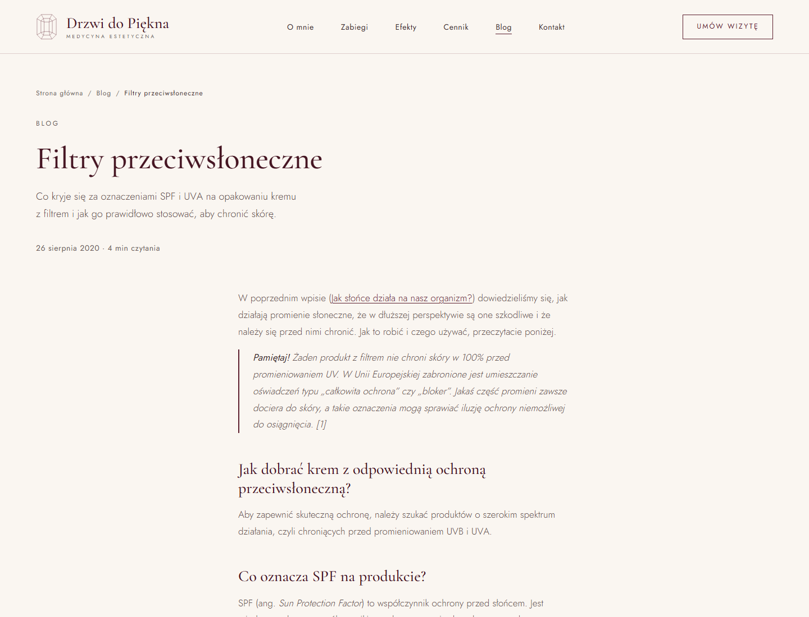 |

Polityka prywatności ma gotowy szkielet pod treść od prawnika:

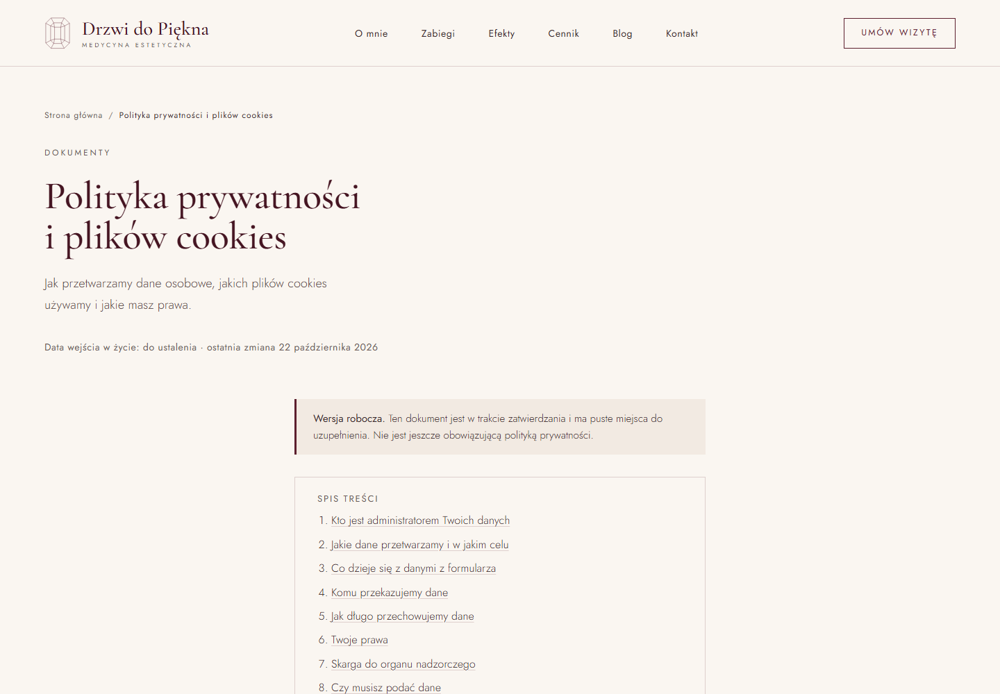

### Telefon

Projekt jest mobile-first (punkty graniczne 640 i 1024 px).

| Strona główna | Zabiegi | Wpis na blogu |
|---|---|---|
|  | 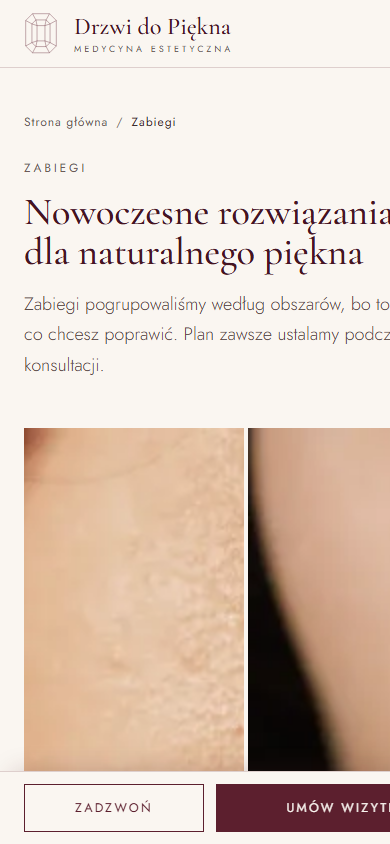 | 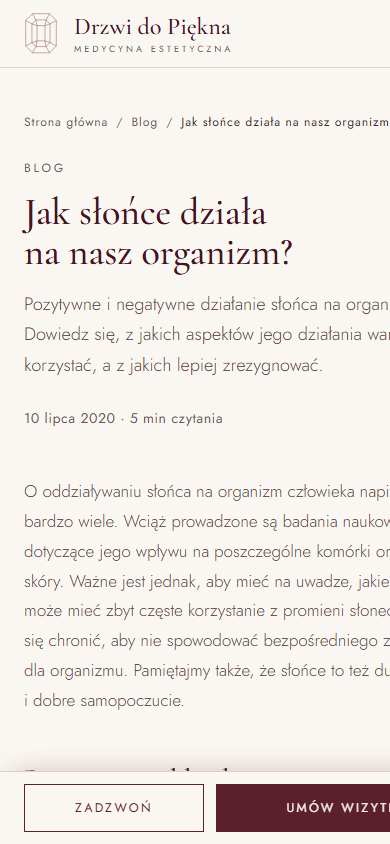 |

### Panel redakcyjny

| | |
|---|---|
| 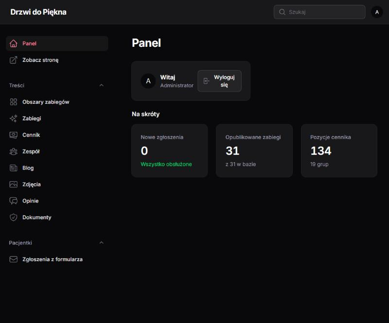 | 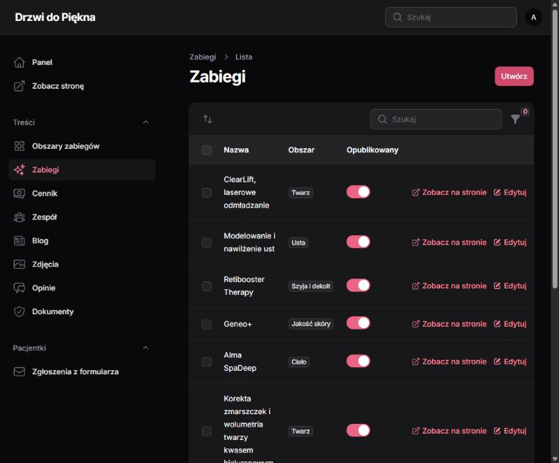 |
| 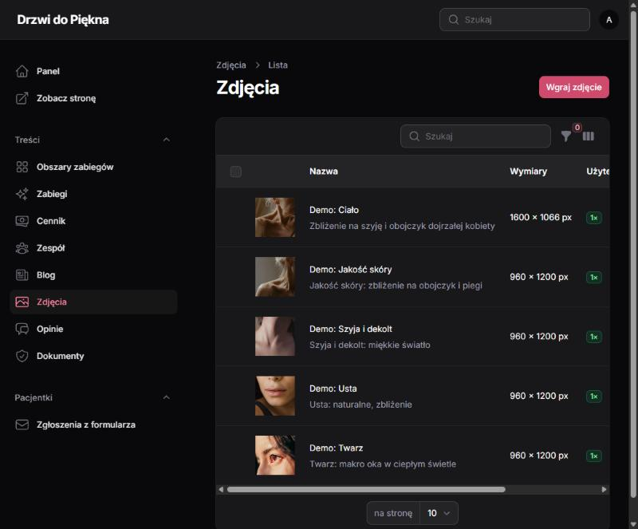 | 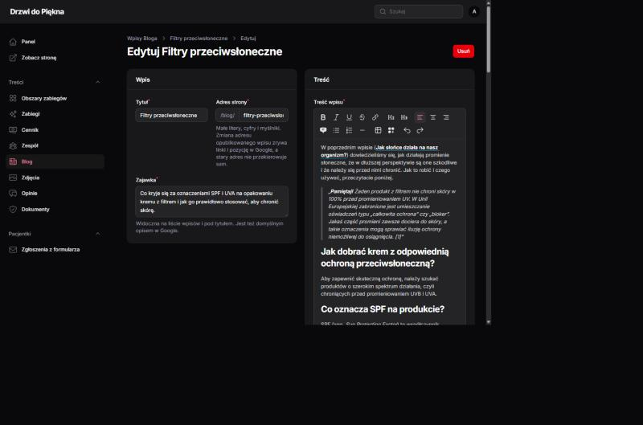 |

### Wiadomość do osoby, która wysłała formularz

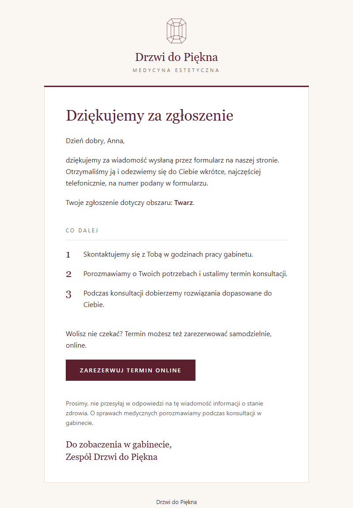

## Stack

- PHP 8.3+ (produkcja 8.4), Laravel 13
- Inertia 3, Vue 3 (`<script setup>`, bez TypeScriptu) z SSR, Vite 8
- Filament 5 jako panel redakcyjny
- Baza: PostgreSQL w produkcji, MySQL lokalnie (Laragon). Kod działa na obu, testy także na SQLite
- Własny system UI w `resources/css/ddp/` (klasy `ddp-*`), układ stron w `resources/css/site.css`
- Zdjęcia przetwarza `sharp` (źródła) i GD z obsługą WebP (wgrywanie w panelu)

## Uruchomienie lokalnie

```bash
composer install
npm install
cp .env.example .env && php artisan key:generate
# w .env ustaw bazę (lokalnie MySQL: DB_CONNECTION=mysql, produkcja PostgreSQL), potem:
php artisan migrate --seed   # tabele i dane zabiegów, cennika, zespołu, bloga i dokumentów
php artisan storage:link     # zdjęcia z panelu
php artisan serve            # http://127.0.0.1:8000
npm run dev                  # Vite z SSR w trybie deweloperskim
```

Animację powitalną widać po dopisaniu `?intro` do adresu (normalnie gra raz na sesję).

Konto do panelu lokalnie: w `.env` ustaw `ADMIN_EMAIL` i `ADMIN_PASSWORD`, a `php artisan migrate --seed` je założy. W produkcji seeder tego nie robi.

## Testy

```bash
npm run build                                                           # szablon wymaga manifestu Vite
php artisan test                                                        # SQLite w pamięci
DB_CONNECTION=mysql DB_DATABASE=drzwi_do_piekna_test php artisan test   # MySQL
```

CI (`.github/workflows/tests.yml`) uruchamia testy na SQLite, PostgreSQL i MySQL oraz sprawdza build produkcyjny.

## Panel redakcyjny

Panel Filament jest pod `/admin` (zabiegi, obszary, cennik, zespół, opinie, blog, zdjęcia, dokumenty, zgłoszenia z formularza).

- **Produkcja**: konto zakłada się ręcznie, `php artisan make:filament-user`. Po `composer install` zasoby panelu publikuje `filament:upgrade` (jest w skryptach Composera).
- Zgłoszenia z formularza zawierają dane pacjentek. Panel dostępny tylko po zalogowaniu, w produkcji ukryty w `robots.txt`. Zgłoszenia są tylko do odczytu i zamykania.
- **Zdjęcia z panelu** trafiają do `storage/app/public/photos`. Wymagają dowiązania `php artisan storage:link` (lokalnie i na serwerze, raz) oraz rozszerzeń PHP `gd` (z obsługą WebP) i `exif`. Limity: `upload_max_filesize` i `post_max_size` co najmniej 12M, w nginx `client_max_body_size 12m`. Przy wdrożeniach z katalogami wydań `storage` musi być współdzielony między wydaniami, inaczej zdjęcia znikną.
- `php artisan photos:import-demo` wgrywa zdjęcia demonstracyjne obszarów do biblioteki (do pokazów, nie na produkcję).
- **Dwuskładnikowe logowanie (2FA):** aplikacja uwierzytelniająca + kody odzyskiwania, w produkcji wymagane (konfiguracja przy pierwszym logowaniu, potem avatar, Profil). Reset po utracie telefonu: `php artisan admin:reset-2fa adres@konta.pl`.
- **Polityka prywatności i cookies** (Treści, Dokumenty): gotowy szkielet z polami `[w nawiasach]` do uzupełnienia przez prawnika. Do czasu zatwierdzenia strona ma dopisek „Wersja robocza”, a `php artisan legal:check` (uruchamiany przez `deploy/deploy.sh`) blokuje wdrożenie produkcyjne.
- **Blog** (Treści, Blog): treść w edytorze wizualnym, zdjęcia wstawiane blokiem „Zdjęcie” albo „Zdjęcia obok siebie” z biblioteki, tabele przyciskiem tabeli. Wpis z przyszłą datą publikacji pojawi się sam.

## Wdrożenie

Przygotowanie na serwer VPS (nginx, PHP-FPM, PostgreSQL, SSR pod Supervisorem), skrypty i lista rzeczy, które jeszcze blokują start:
[docs/DEPLOY.md](docs/DEPLOY.md). Staging na `demo.cerasusdigital.pl` stawia jedno polecenie na czystym Ubuntu: `deploy/provision-staging.sh`
(opis w sekcji „Staging” w DEPLOY.md). Pliki w `deploy/`, szablon środowiska w `.env.production.example`. Po wdrożeniu:
`bash deploy/check-redirects.sh https://domena` (stare adresy WordPressa) i `bash deploy/check-ssr.sh https://domena`.

Build produkcyjny:

```bash
npm run build                 # klient + bundle SSR (bootstrap/ssr)
php artisan inertia:start-ssr # proces Node, nadzorowany przez Supervisor lub systemd
```

## Zdjęcia

Źródła w `resources/images/source`, kadry w `scripts/images.mjs`. Po zmianie zdjęć lub kadrów: `npm run images` (WebP w kilku szerokościach do `public/images` i manifest `resources/js/images.json`). Zdjęcia demonstracyjne są z Pexels, lista w `resources/images/CREDITS.md`. W komponentach Vue zdjęcia zawsze przez komponent `Picture`.

Szablon wiadomości e-mail używa sygnetu z `resources/mail/signet.png`, generowanego poleceniem `npm run mail-assets`.

## Gdzie co jest

- Wygląd: `resources/css/ddp/` (system UI Drzwi do Piękna) i `resources/css/site.css` (układ stron).
- Treści: `lang/pl/home.php`, `lang/pl/pages.php`. Dane gabinetu i nawigacja: `config/clinic.php`. Treści zabiegów, cennika i zespołu są w bazie (seedery w `database/seeders`).
- Strony Inertia: `resources/js/pages`, komponenty: `resources/js/components`.
- Panel: `app/Filament/Resources/<Nazwa>/`.
- SEO: `app/Support/Seo.php` i `resources/views/app.blade.php`.
- Plan i decyzje projektowe: [docs/PLAN.md](docs/PLAN.md). Konwencje dla pracy z kodem: [CLAUDE.md](CLAUDE.md).

## Stan prac

Technicznie gotowe do pokazu klientce. Przed publicznym startem zostają rzeczy po stronie gabinetu i serwera: prawdziwa treść polityki prywatności i zgody RODO od prawnika, zdjęcia i opinie od klientki (dziś są zdjęcia demonstracyjne i pola `[w nawiasach]`), poczta (SMTP, SPF, DKIM), pierwsze uruchomienie na PostgreSQL na serwerze oraz test Lighthouse. Pełna lista w [docs/DEPLOY.md](docs/DEPLOY.md).
